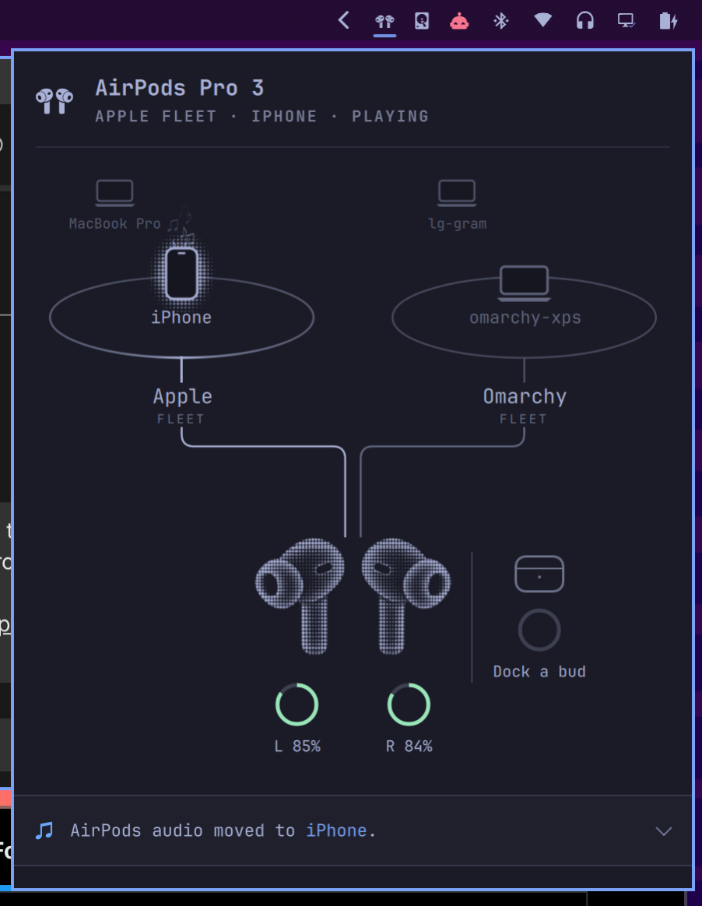
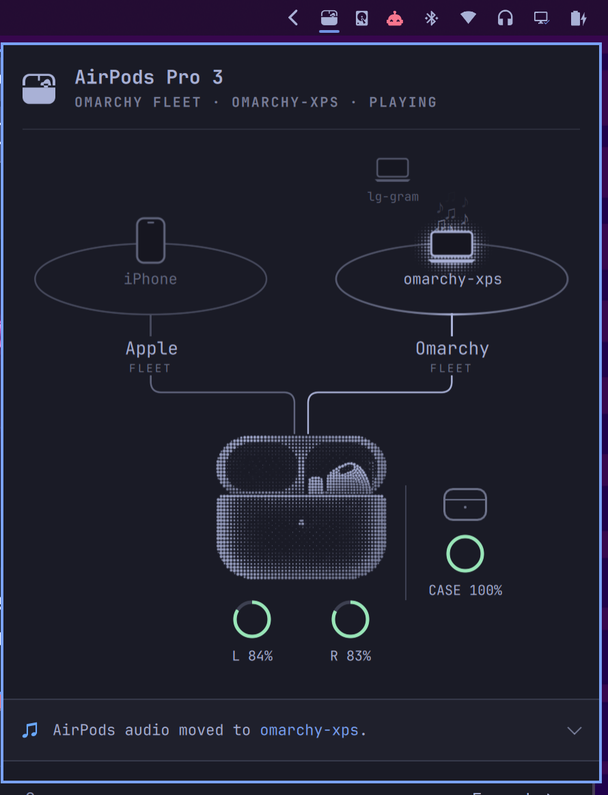

# FleetPods



## The Problem

AirPods are some of the best earbuds on the market, and they work wonderfully so long as everything you own is made by Apple.

The trouble starts when you add a third device that isn’t made by Apple. Swapping back and forth between two devices works fine. But if the last audio you played was on an Omarchy machine, pressing play on your iPhone or Mac may not automatically pull the AirPods back. It depends on which Apple device, if any, still has a background connection to them, and there’s no clear way to tell which devices are connected. So you end up switching the pods manually through the Bluetooth menu on your Mac, over and over: a huge step backwards in usability.

The key to seamless switching across three or more devices is a smart routing request: a device that wants to connect asks a connected device to make room. Apple sends these requests only to other Apple devices signed into the same Apple account. An Omarchy machine can hold one of the AirPods’ two connections, but it never receives that request. The connection works; the coordination needed to share it is missing.

## How FleetPods Helps

FleetPods adds that request and yield coordination between Omarchy machines, along with a live view of the AirPods’ connections. A fleet member that wants to connect can ask a connected member to make room, while the plugin shows which devices are connected and which one owns the audio. These requests travel over encrypted Bluetooth Low Energy advertisements, authenticated with a shared fleet key. New devices join the fleet through a short pairing-code exchange.

## What the Plugin Shows



The Omarchy plugin shows the state of play: which devices currently hold the two AirPods connections, which fleet devices are nearby, when an Apple device can take over seamlessly, and when a manual connection is still required.

## Where This Is Going

Future versions may include a macOS daemon that speaks the FleetPods protocol, so every machine in the fleet, Apple or not, can request and yield the AirPods the same way.

I’d also like to expand support to AirPods Max, other AirPods Pro models, and standard AirPods. I just need to buy them all so I can test them properly.

FleetPods includes a Rust daemon and an Omarchy plugin. Behavior is specified in [REQUIREMENTS.md](REQUIREMENTS.md).

## Features

- **Automatic AirPods switching:** Move audio between Omarchy machines in your fleet when you press play.
- **Encrypted fleet protocol:** Omarchy machines that have joined your fleet discover nearby members and coordinate connection and audio routing over Bluetooth.
- **High-resolution microphone support:** Use the AirPods Pro 3 microphone for calls and recording.
- **Live connection view:** See the state of your AirPods, which devices occupy each of their two connections, and which device is playing audio.

## Layout

```
src/           the Rust daemon
  types/       shared words: addresses, clocks, evidence, model data
  pods/        this machine's AirPods: link, reports, saved preferences
  fleet/       the other computers: nearby hosts, enrollment, members, routes
  audio/       this machine's sound: playback, microphone, who is playing
  panel/       the socket verbs and the status snapshot
  linux/       signals, paths, BlueZ, and the control socket
  daemon.rs    the one struct; sends each command to one module
  bin/         fleetpodsd, fleetpods
plugin/        the Quickshell panel
```

`plugin/` holds the QML and `Model.js`. The Omarchy manifest at this repository root points at `plugin/Panel.qml`. The panel reads the status file and runs `fleetpods`. It does not import the crate. `src/panel/` is the daemon side of that same contract.

The socket is `$XDG_RUNTIME_DIR/fleetpods.sock`. The status file is `${XDG_STATE_HOME:-~/.local/state}/fleetpods/status.json`. An unset or unsafe runtime directory is an error. There is no `/tmp` fallback.

`pods`, `fleet`, and `audio` return effects. They do not open BlueZ or PipeWire themselves. Status JSON is not read back into a decision. The field map is [docs/status-fields.md](docs/status-fields.md). How the modules divide the work is [docs/architecture.md](docs/architecture.md).

## Install

On Omarchy with shell plugin support, install Rust and Cargo and the [build dependencies](docs/installation.md#requirements), then run from this checkout:

```sh
./setup
```

This builds FleetPods, installs its user service and microphone support, and enables the plugin in the bar. Open the FleetPods icon to get started. Pair your AirPods through Bluetooth if this is their first connection to the machine.

See the [installation guide](docs/installation.md) for cloning, first pairing, joining a fleet, upgrades, and removal. AirPods Pro 3 is the current tested hardware; see [support and known limitations](docs/support.md) for compatibility and troubleshooting.

Check the connection with:

```sh
fleetpods status
```

To test joining a fleet again, run `fleetpods fleet reset` while the daemon is running. This resets only this machine’s fleet membership and keeps its AirPods pairing.

To forget one member locally, run `fleetpods fleet remove <Bluetooth address>`. This keeps the other members and AirPods pairing. It does not reset the removed device or rotate the shared fleet key.

## License

FleetPods is dual-licensed under the [MIT License](LICENSE-MIT) or the [Apache License 2.0](LICENSE-APACHE), at your option.

FleetPods uses permissive licenses to make it easy for others to use, improve, and build on the project, including in commercial products. I believe the lasting value of open source comes from the community, shared knowledge, and ecosystem around it. Making the code easy to reuse invites scrutiny and collaboration, helping that community grow and the software improve.
