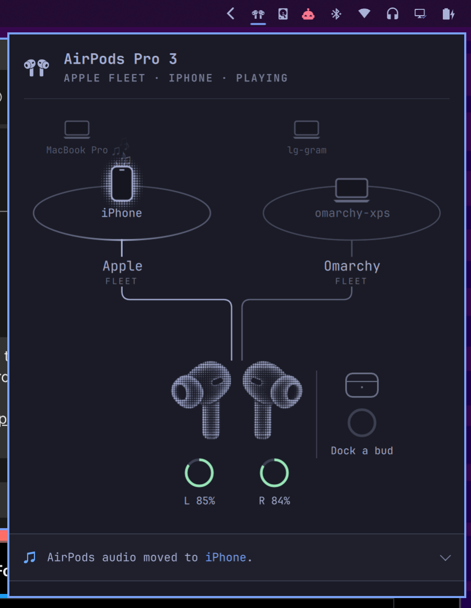
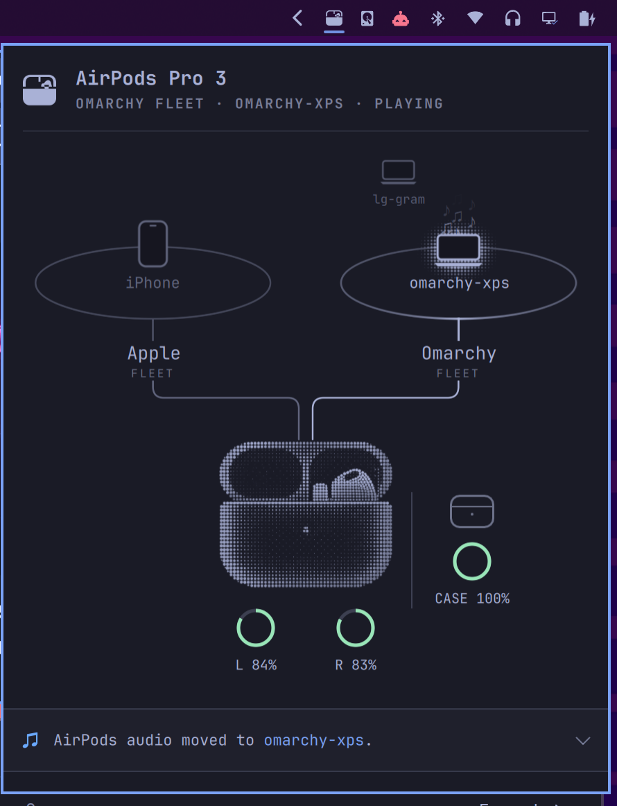
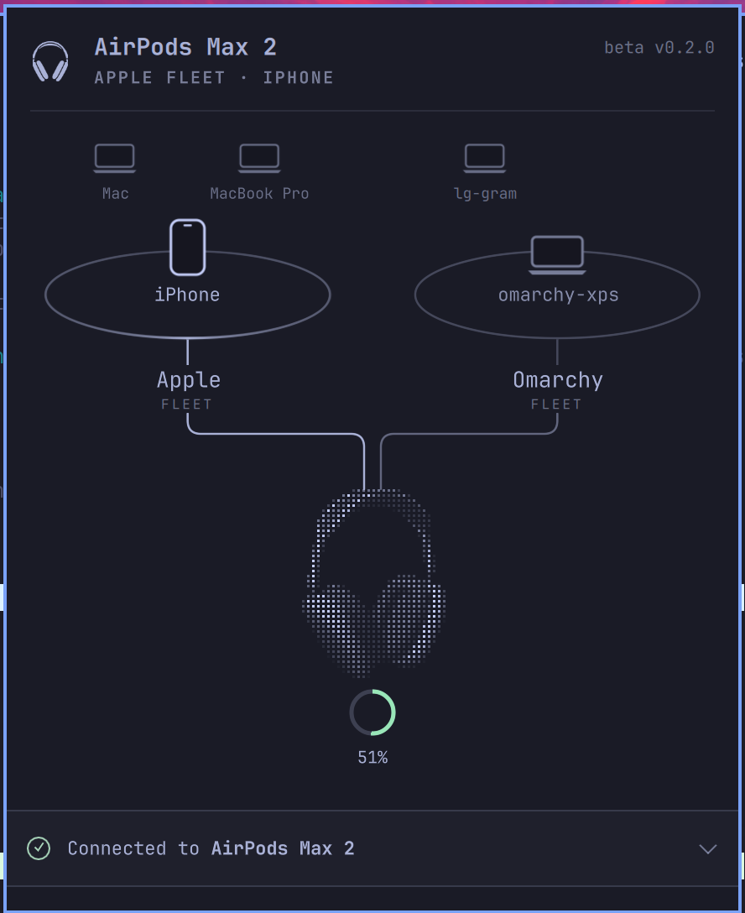

# FleetPods

**Your AirPods, on every computer you own.**

[](https://plugins.omarchy.org/plugin.html?id=io.github.danmacdonald.fleetpods)
[](https://github.com/DanMacDonald/fleetpods/releases)



**FleetPods is in beta.** It is tested with AirPods Pro 3 and AirPods Max 2, and also works with AirPods Pro 2. Fleet roster management, the rest of the AirPods catalog, and a cleaner animation core are the goals for version 1.0.

## The Problem

AirPods are some of the best earbuds on the market, and they work wonderfully so long as everything you own is made by Apple.

The trouble starts when you add a third device that isn’t made by Apple. Swapping back and forth between two devices works fine. But if the last audio you played was on an Omarchy machine, pressing play on your iPhone or Mac may not automatically pull the AirPods back. It depends on which Apple device, if any, still has a background connection to them, and there’s no clear way to tell which devices are connected. So you end up switching the pods manually through the Bluetooth menu on your Mac, over and over: a huge step backwards in usability.

The key to seamless switching across three or more devices is a smart routing request: a device that wants to connect asks a connected device to make room. Apple sends these requests only to other Apple devices signed into the same Apple account. An Omarchy machine can hold one of the AirPods’ two connections, but it never receives that request. The connection works; the coordination needed to share it is missing.

## How FleetPods Helps

FleetPods adds that request and yield coordination between Omarchy machines, along with a live view of the AirPods’ connections. A fleet member that wants to connect can ask a connected member to make room, while the plugin shows which devices are connected and which one owns the audio. These requests travel over encrypted Bluetooth Low Energy advertisements, authenticated with a shared fleet key. New devices join the fleet through a short pairing-code exchange.

## What the Plugin Shows



The Omarchy plugin shows the state of play: which devices currently hold the two AirPods connections, which fleet devices are nearby, when an Apple device can take over seamlessly, and when a manual connection is still required.

> [!NOTE]
> **Known issue on macOS:** macOS does not report media pauses to the AirPods right away. After you pause on a Mac, the plugin may keep showing the Mac as playing for 5–10 seconds before the pause clears. Pauses on an iPhone clear almost immediately. FleetPods displays the state as soon as the AirPods report it; the delay is in macOS's reporting, not in the plugin.

## Supported AirPods



FleetPods keeps track of every pair of AirPods you have paired and follows the one you are using. Putting a pair on, or pressing play on it, makes it the active pair. Each pair keeps its own listening settings.

| AirPods | Status | Panel artwork |
| --- | --- | --- |
| AirPods Pro 3 | Tested: switching, battery, listening controls, high-resolution microphone | Dot-mesh earbuds and case |
| AirPods Max 2 | Tested: switching, wear detection on each cup, high-resolution microphone | Dot-mesh headset |
| AirPods Pro 2 | Works, with less testing; high-resolution microphone checked on the Lightning model | Dot-mesh earbuds and case |
| Other AirPods | Not yet validated; discovery and some controls may work | Outline icon |

See [support and known limitations](docs/support.md) for the details of what was tested.

## Features

- **Automatic AirPods switching:** Press play on any machine in your fleet and the AirPods move there. The machine giving them up mutes and pauses first, so nothing plays through the wrong speakers.
- **Activity takes an idle seat:** When two fleet machines are connected and nothing is playing, using one makes it the audio owner without dropping either connection.
- **Works alongside Apple devices:** FleetPods does not pull the AirPods away from an iPhone or Mac that is playing, and if one takes them back while this machine connects, the notification names it. **Reconnect** on the Apple seat briefly releases the Omarchy connections so an Apple device can get back on, then reconnects this machine.
- **Encrypted fleet protocol:** Machines in your fleet find each other and coordinate over encrypted, authenticated Bluetooth Low Energy advertisements. New machines join with a six-digit pairing code.
- **Multiple pairs of AirPods:** Several pairs are tracked at once, with the pair you are wearing or playing on taking over.
- **Listening controls:** Right-click the bar icon to cycle noise control (Off, Noise Cancellation, Transparency, Adaptive). The `fleetpods` command also sets the adaptive level, Conversation Awareness, single-bud noise cancellation, and what happens when you take the AirPods off, as each model supports them.
- **Ear detection:** Playback pauses when you take a bud out or lift a Max cup, and resumes when you put it back. FleetPods resumes only playback it paused itself.
- **High-resolution microphone:** The AirPods microphone records at 64 kHz on AirPods Pro 3, Pro 2 (Lightning), and Max 2, while playback stays in stereo.
- **Live connection view:** See which devices hold each of the AirPods' two connections, which one is playing, nearby fleet machines, and battery for each bud, the case, or the headset.
- **Notifications:** A notification follows each connection from start to playing, and one shows volume changes made on the AirPods.
- **Audio recovery:** If playback goes silent while this machine owns the AirPods, FleetPods reopens the audio output automatically; `fleetpods audio reset` does the same on demand.

## Road to 1.0

Version 1.0 targets:

- **Fleet roster management:** A clear view of fleet membership, with controls for adding and removing devices and leaving a fleet.
- **Full AirPods hardware support:** Support the full Apple AirPods catalog, including AirPods, AirPods Pro, and AirPods Max, with each model tested on real hardware.
- **Matching artwork:** Model-specific artwork for standard AirPods, which still show an outline icon.
- **An explicit animation state machine:** Boil the plugin's accumulated animation rules down to a clear set of seat and connection states, with named actions for the transitions between them, replacing the transition logic that grew rule by rule.

**On hold: magic pairing.** Pairing the AirPods with one fleet machine so that every other member can use them without pairing again would mean installing a plugin into the system Bluetooth service, which needs root. FleetPods installs for your user only, without `sudo`, so this is paused. The investigation is kept on the `fleet-pairing` branch.

Future versions may also include a macOS daemon that brings Apple computers into the FleetPods protocol, so every machine in the fleet can request and yield the AirPods the same way.

FleetPods includes a Rust daemon and an Omarchy plugin. Behavior is specified in [REQUIREMENTS.md](REQUIREMENTS.md).

## Layout

```
src/             the Rust daemon
  types/         shared words: addresses, clocks, evidence, model data
  pods/          this machine's AirPods: link, reports, saved preferences
  fleet/         the other computers: nearby hosts, enrollment, members, routes
  audio/         this machine's sound: playback, microphone, who is playing
  panel/         the socket verbs and the status snapshot
  linux/         signals, paths, BlueZ, and the control socket
  daemon.rs      the one struct; sends each command to one module
  daemon/        the connection session and when to reopen it
  step.rs        one input, one clock, a list of effects
  retry.rs       shared retry timing, budgets, and stale-reply rejection
  handshake.rs   the pairing-code exchange that admits a new member
  devices.rs     names of the Apple devices the AirPods have connected to
  bin/           fleetpodsd, fleetpods
plugin/          the Quickshell panel and its dot-mesh artwork
wireplumber/     the microphone hooks for WirePlumber 0.5
packaging/       the systemd user service
tests/           acceptance scenarios, run with `cargo xtask test`
tools/artwork/   the artwork pipeline, previews, and logo
docs/            guides, design notes, and validation reports
```

`plugin/` holds the QML and `Model.js`. The Omarchy manifest at this repository root points at `plugin/Panel.qml`. The panel reads the status file and runs `fleetpods`. It does not import the crate. `src/panel/` is the daemon side of that same contract.

The socket is `$XDG_RUNTIME_DIR/fleetpods.sock`. The status file is `${XDG_STATE_HOME:-~/.local/state}/fleetpods/status.json`. An unset or unsafe runtime directory is an error. There is no `/tmp` fallback.

`pods`, `fleet`, and `audio` return effects. They do not open BlueZ or PipeWire themselves. Status JSON is not read back into a decision. The field map is [docs/status-fields.md](docs/status-fields.md). How the modules divide the work is [docs/architecture.md](docs/architecture.md).

## Install

On Omarchy with shell plugin support, install Rust and Cargo and the [build dependencies](docs/installation.md#requirements), then run from this checkout:

```sh
./setup
```

This builds FleetPods, installs its user service and microphone support, and enables the plugin in the bar. Open the FleetPods icon to get started. Pair your AirPods through Bluetooth if this is their first connection to the machine.

Setup does not need `sudo`. Everything is installed for your user only:

- the binaries go to `~/.local/bin`;
- the daemon becomes a `systemctl --user` service;
- the plugin goes to `~/.config/omarchy/plugins`;
- the microphone support goes to your WirePlumber config under `~/.local/share` and `~/.config`.

Nothing is written to `/etc` or `/usr`, and there are no udev rules, group changes, or file capabilities. The daemon uses Bluetooth, PipeWire, media players, and the keyring with your session's normal permissions. You need `sudo` only to install a missing build dependency with `pacman`. `./setup --bin-dir DIRECTORY` installs already-built binaries and skips the build and its dependency checks.

See the [installation guide](docs/installation.md) for cloning, first pairing, joining a fleet, and upgrades. See [support and known limitations](docs/support.md) for compatibility and troubleshooting.

## Remove

To remove the service, plugin, binaries, and microphone support:

```sh
fleetpods fleet reset   # optional: leave the fleet first, while the daemon runs
systemctl --user disable --now fleetpods.service
omarchy plugin remove io.github.danmacdonald.fleetpods --yes
rm -f ~/.local/bin/fleetpods ~/.local/bin/fleetpodsd
systemctl --user daemon-reload
```

Saved fleet membership, keyring records, and Bluetooth pairing stay in place for a later reinstall; the full removal steps, including the microphone files, are in the [installation guide](docs/installation.md#remove-fleetpods).

Check the connection with:

```sh
fleetpods status
```

To test joining a fleet again, run `fleetpods fleet reset` while the daemon is running. This resets only this machine’s fleet membership and keeps its AirPods pairing.

To forget one member locally, run `fleetpods fleet remove <Bluetooth address>`. This keeps the other members and AirPods pairing. It does not reset the removed device or rotate the shared fleet key.

## License

FleetPods is dual-licensed under the [MIT License](LICENSE-MIT) or the [Apache License 2.0](LICENSE-APACHE), at your option.

FleetPods uses permissive licenses to make it easy for others to use, improve, and build on the project, including in commercial products. I believe the lasting value of open source comes from the community, shared knowledge, and ecosystem around it. Making the code easy to reuse invites scrutiny and collaboration, helping that community grow and the software improve.
